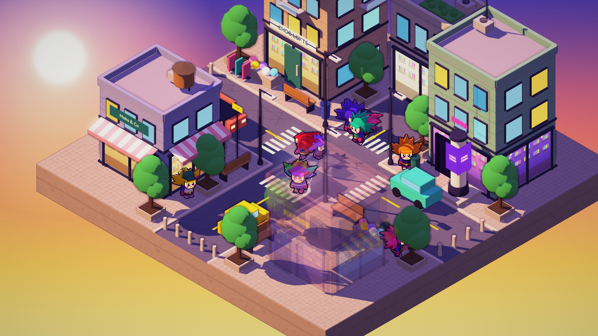
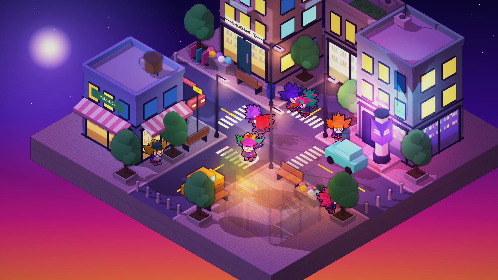

# Art direction

## World and style

A small modern city district on a floating slab: two avenues crossing, a tower that will be the Hotel ("Chog Hotel", venues, not built yet), a small Home house for every player, a cafe, an arcade, a club, a gallery, street furniture (lamps, benches, bus stop, cars, trees). Direction changed on 2026-10-08 from the medieval island to **modern**; the render style did not change.

**Render style:** smooth stylised 3D (the `hybrid` style): a real 3D scene rendered 2x supersampled (3840x2160 down to 1920x1080), soft toon shading, ambient occlusion, saturated colours, glow, light vignette. Palette accents come from Chog itself: purple and magenta against warm cream, terracotta and sky gradient. Pixel-3D stays as `?style=pixel` for reference only.

**Outlines:** Chogs get a thick ink outline (as in the official art): ink hulls around each part plus one continuous screen-space outline around the whole silhouette, hair blades included (a mask pass, see `docs/engineering/prototype.md`). The environment gets only a thin, light, warm line, so it never competes with the characters. Faces get no ambient occlusion and no cast shadows so they stay cream and readable.

**Time of day follows the real clock** (`js/daycycle.js`): dawn and dusk = the warm golden look, midday = bright pastel, night = purple neon dusk with stars, moon, lit windows, lamp pools and glowing signs; keyframes blend smoothly. Same buildings and colours at every hour, only light, sky and what is switched on change, so the look stays one world. Settings can pin an hour (`?hour=22` too).

Do: readable silhouettes, purple shadows, warm light, small lit details (windows, lamps, signs), Chogs always the clearest thing on screen.
Don't: milky haze (fog starts at distance 112 for a reason), blown-out highlights (the first "day" look had them: keep the sun below about 0.6 and facades pastel), tilt-shift or other blur at the screen edges, cluttering the area where Chogs walk.

Kit rules for new buildings: flat roofs with a parapet and a few roof props, window grids as instanced meshes (never one mesh per window), shopfronts with a lit interior, one sign per building, awnings in two colours, at most 5 floors. Chogs must read clearly next to doors (1.85 high).

## Asset language: one style, many themes (applies to EVERY asset)

Decided by the owner 2026-10-08. The game has one art style and one render pipeline; assets never introduce another. This covers the city, stock rooms, creator rooms, items, wallpapers, floors, backgrounds, UI icons and Chogs.

- **Variety is theme, not style.** We offer a wide catalogue of themes (modern, cyberpunk, retro 80s, space, halloween, and more over time) so a player can make a halloween house or a space station, but every piece is built in the same visual language: chunky toon shapes, saturated palette, small lit details, readable silhouettes, shared proportions.
- **How a theme is made:** a palette, a default wall and floor, a set of pieces. Never a different shader, outline, realism level, pixel look or photo texture.
- **Colours and patterns are free for players; shapes and scale are shared.** Wallpapers, floors and backgrounds come from a pattern list tinted with any colour.
- **Light is the world's, not a style.** The real clock lights only the outdoors and the view through windows. Interiors are lit only by the lights placed in them (`docs/game/world.md`).
- Details and the creator toolset: `docs/game/spaces.md`. A `?style=` switch exists for developers only.

## UI style: three skins

Chosen by the owner 2026-10-08 from three concepts. **Warm cards is the default**; Neon night and Storybook stay as options in Settings (`O`), saved in `localStorage` (`chog_skin`). Skins are CSS only: classes `warm` / `neon` on `#ui` and `<body>` (nameplates live outside `#ui`), none = Storybook. All live in `css/ui.css`; the structure is built once in `js/ui.js`.

- **Warm cards:** cream cards `#fffaf3` with a soft 1.5px line and shadow, 16-22px radius, Chog purple `#7a3ac8` for primary actions and the active slot, magenta/gold accents, Fredoka for titles and buttons, Nunito for text. No wood, no parchment.
- **Neon night:** dark glass `rgba(20,10,44,.8)`, 1px cyan lines with a pink second line, glow, Rubik and Bungee. Reads best at night, weaker by day.
- **Storybook:** the original wood (`#3a2012 ... #a8703c`) and parchment (`#f6e6bd / #ead3a0`) look with Bree Serif; kept for those who like it.
- **Layout (desktop, drawn for 1440x810, scaled with window height):** player frame top-left, round minimap with a location ribbon and the wallet button top-right, chat bottom-left, action bar bottom-centre (My Chog, My Room, Market, Venues, Settings, each with a key; My Room and Market are placeholders until those features exist, see `docs/game/design.md`), control hint above it, toast top-centre. Windows open centred above the action bar and never cover it.
- **Windows:** one card per feature: hero image on top (Chog on its background colour, tier ribbon, close button), title, chips or rows, a dashed inner box, actions at the bottom. Reuse `card()` / `settingsCard()` / `venuesCard()` in `ui.js`.
- **Venue license UI (2026-10-08):** a small coloured pill "Tier N" (no name) under the player frame, only for holders; a license card in My Chog (holders only: points per rarity, a progress bar with the tier marks, what the next tier needs); the Venues window shows the four-tier ladder with how many wallets hold each tier (and a "snapshot of <date>" note), a star on yours, ticks below, locks above. Free players get no pill and no card, only the ladder with "Get a Chog". Tier colours: grey, blue, purple, gold (Tier 2 to 4 follow Rare, Epic, Legendary). Styles in `ui.css` use `currentColor` tints, so all three skins work.
- **Nameplates:** a small tag with a tier-coloured dot floats above every Chog (`js/plates.js`); the player's own tag has a gold ring; chat lines appear as speech bubbles above the speaker. Tags hide behind buildings.
- **Icons:** simple 2px line icons (inline SVG, `ICONS` in `ui.js`). A proper hand-drawn set is a later task.
- **Mobile:** not styled yet; it is a later companion (see `docs/game/design.md`).

## Chog design rules

Derived from the official art (`assets/reference/official_sheet.png`). The NFT portraits are crops; do not model proportions from them.

- Large spiky hair mass: broad leaf-like blades swept back and outward, one continuous crown.
- Small cream mask face with a jagged hairline, big black eyes with highlights, pink round cheeks, small pink triangle nose, small smile.
- Chunky tapered body, short limbs, arms grow from shoulder caps; magenta cuffs, mitten hands, boots.
- Look: soft 4-step toon shading, thick ink outline on body parts (not on hair blades), unlit decals for the face.
- Traits map to parameters of `chog()`: `hair`, `suit`, `outfit` (vest/tunic/jacket/apron), `head` (straw/crown/headset/cap), `scarf`, `item`, `eyes`/brows.

## Scale rules (world units)

| Thing | Size |
|---|---|
| Chog | ≈ 1.4 tall (default scale 0.74) |
| Door | 1.75 tall |
| Building body | 4 to 10 (1 to 5 floors of 1.5) |
| Trees | 3 |
| Town slab | 20.8 × 20.8 (`HALF` 10.4), roads 3 wide |

Chogs must always read smaller than doors and houses.

## Known limits

- Chog is still polygonal compared with the smooth official illustrations.
- Buildings and trees fade to nearly invisible when they hide the player (`game.js`); the fade is abrupt and shop interiors flicker through. Crowd Chogs behind buildings are not faded.
- Supersampling (2x) is expensive and untested on weaker GPUs. The shipping pipeline may need a render-scale setting. The mobile companion needs no full scene, only a low-resolution security-camera view of an owner's venue (noise and scanlines by design; see `docs/game/design.md`).
